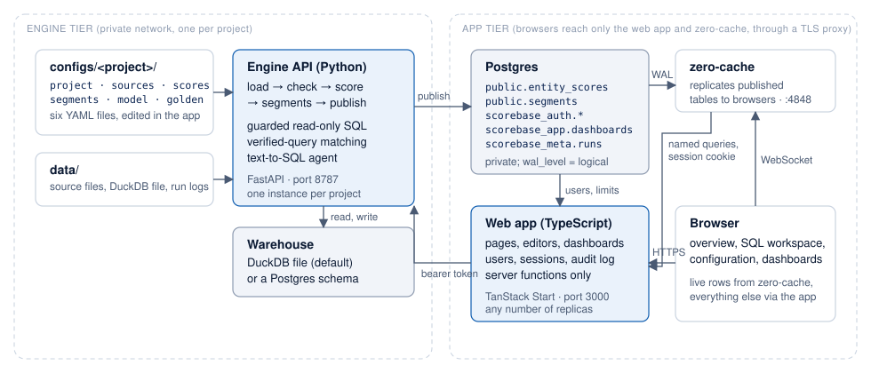
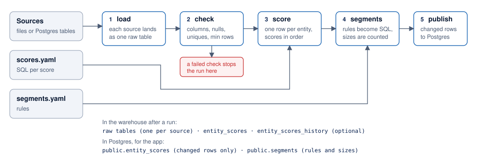
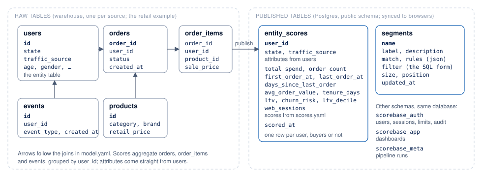
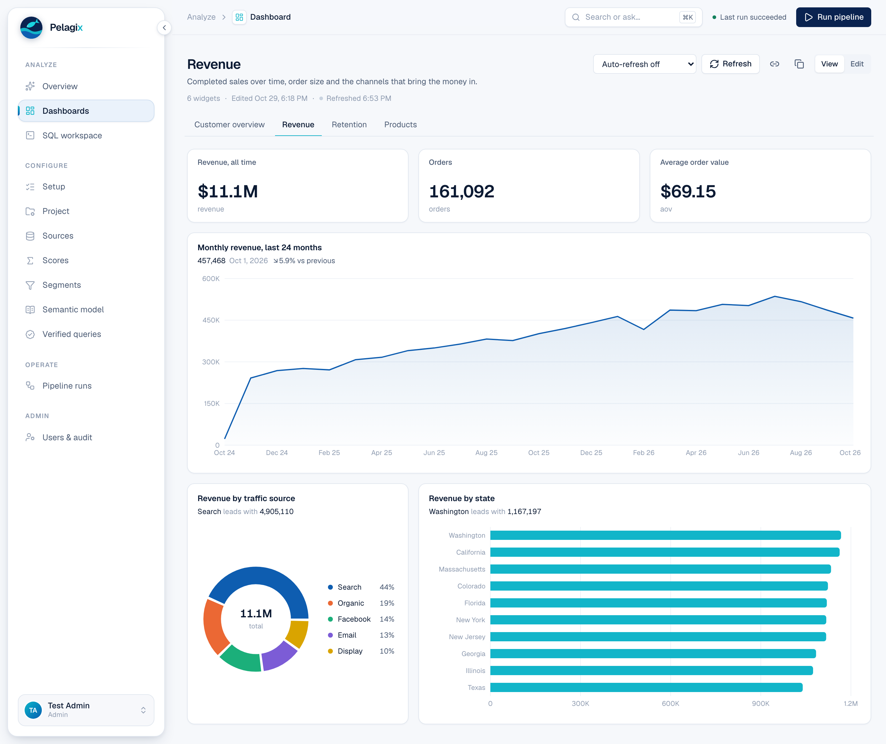
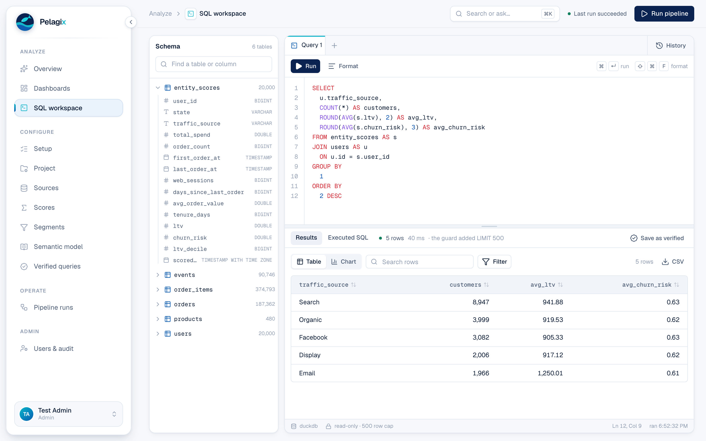

# Pelagix

Pelagix turns raw tables into per-entity scores and segments, publishes them to Postgres, and serves them through a web app that syncs live and answers plain-English questions with verified SQL.

It is built for teams that have customer, account or device data in files or a database and want scores such as lifetime value, churn risk or engagement computed on a schedule, kept consistent, and available to non-technical users without a BI tool in between.

Everything domain-specific lives in YAML under `configs/<project>/`. The engine itself is generic: the test suite scores countries from labor statistics with the same code and a different config.


## Contents

- [Features](#features)
- [How it works](#how-it-works)
- [Requirements](#requirements)
- [Quick start with the demo data](#quick-start-with-the-demo-data)
- [Using your own data](#using-your-own-data)
- [Configuration](#configuration)
- [The web app](#the-web-app)
- [Ask: verified queries and the agent](#ask-verified-queries-and-the-agent)
- [Command line](#command-line)
- [Engine API](#engine-api)
- [Environment variables](#environment-variables)
- [Deployment](#deployment)
- [Testing](#testing)
- [Repository layout](#repository-layout)
- [Security model](#security-model)
- [Known limitations](#known-limitations)
- [Contributing and license](#contributing-and-license)

## Features

**Scoring engine**

- Loads CSV, Parquet and JSON files (including globs and allowed remote URLs) or Postgres tables into a warehouse, in replace or incremental mode.
- Runs per-source data checks (required columns, not-null, unique, minimum rows) and stops the run before anything is scored or published if one fails.
- Computes scores from SQL expressions. A score may reference other scores by name; the engine orders them by dependency. A score may aggregate a different table than the rest with its own `from`, `where` and `key_expr`.
- Gives every entity a row, including entities with no activity, using per-score defaults. Carries chosen entity attributes (such as a state or channel) into the score table.
- Defines segments as structured rules over scores and attributes: all or any, comparisons, `in`, `not_in`, null checks, numbers or text.
- Publishes to Postgres writing only the rows that changed, in one transaction, so the live app sees a small diff instead of a reload. Optionally keeps a history table with one row per entity per run.
- Supports DuckDB (a local file, no server) and Postgres as warehouses. Snowflake support is written but untested.

**Web app**

- Live overview of segments and members, synced from Postgres to the browser through [Zero](https://zero.rocicorp.dev). An edit to a row in Postgres shows in open pages in about a second.
- Entity drawer with every score and attribute, a distribution chart per score, CSV export.
- SQL workspace behind the same read-only guard as the agent, with a table browser, formatting, history, and one-click promotion of a result to a verified query.
- Editors for every configuration file with validation as you type, errors shown on the field that caused them, a YAML view, saved versions to restore, live segment sizes and score previews.
- Pipeline runs started from the app with per-step progress and history.
- Users with viewer, editor and admin roles, sessions, lockout after failed sign-ins, per-user rate limits, an audit log, and a forced password change for invited users.
- Dashboards built from widgets: live segment sizes, a metric from a SQL scalar, a score distribution, bar, horizontal bar, line, area or donut charts from any query with a six-color palette, a table, or a note. Editors arrange them on a three-column grid; viewers see them update. Four sample dashboards ship with the demo project.
- Light and dark themes, a command palette, and keyboard-driven forms.

**Ask**

- A question is first matched against verified question-to-SQL pairs. A match is answered instantly and exactly, with no model involved.
- Otherwise a LangGraph agent writes SQL from the semantic model, runs it through the guard, retries on errors up to three times, and summarises the result. Any model available through OpenRouter or Anthropic works.
- An editor can save a checked agent answer as a verified query, so the same question is answered exactly next time and the agent has one more example.

## How it works

### The pieces and how they talk



Four processes run in production. The **engine API** (Python) reads the six YAML files of a project, loads sources into a **warehouse** (a DuckDB file by default, or a schema in Postgres), computes scores and segments, and publishes the results. It is internal: only the web app calls it, with a shared bearer token. **Postgres** holds what the app needs: the published score and segment tables in `public`, users and sessions in `scorebase_auth`, dashboards in `scorebase_app`, and run history in `scorebase_meta`. **zero-cache** replicates the published tables to browsers over a WebSocket, resolving each named query through the app so a session cookie is required. The **web app** (TypeScript) is what people open; it serves the pages, the editors and the dashboards, and it is the only process browsers talk to besides zero-cache.

### What a pipeline run does



A run is five steps in order. Each source lands as one raw table. Data checks run on those tables, and a failure stops the run before anything is scored, so a broken export cannot overwrite good scores. Scoring builds one SQL statement from `scores.yaml`, with scores computed in dependency order, and produces one row per entity. Segment rules become SQL and are counted. Publish copies the score table to Postgres writing only the rows whose values changed, in one transaction, so browsers receive a small diff.

### The tables, using the retail example



The warehouse holds the raw tables exactly as loaded. The published `entity_scores` table has one row per entity (here, per user, whether or not they ever bought), the attributes copied from the entity table, every score from `scores.yaml`, and the time it was scored. The `segments` table holds each segment's rules, the SQL they compile to, and the current size. The app's own tables live in separate schemas of the same database, so one Postgres instance runs the whole stack.

## Requirements

| Component | Version |
|---|---|
| Python | 3.11 or newer |
| Node.js | 22, with pnpm 10 |
| Postgres | 15 or newer, started with `wal_level=logical` (zero-cache replicates from it) |
| Docker | optional, for the bundled Postgres and the full-stack compose profile |

## Quick start with the demo data

The repository ships a `retail` project shaped like the public TheLook e-commerce dataset, with a generator for synthetic customers, orders, items and site events. This walkthrough takes about five minutes.

**1. Install and start Postgres**

```bash
git clone <this repository> && cd scorebase
make setup
```

This creates a Python virtual environment, installs the engine, installs the app's packages, writes `app/.env` with a generated API token, and starts Postgres in Docker on port 5433.

**2. Generate and score the demo data**

```bash
make data
```

This writes 20,000 synthetic customers under `data/retail/`, then runs the pipeline: load, check, score, segments, publish and codegen. The output lists row counts per step. It takes a few seconds on a laptop.

**3. Start the stack**

```bash
make dev
```

Three processes start in one terminal: the engine API on port 8787, zero-cache on port 4848 and the web app on port 3000. Press Ctrl-C to stop all of them.

**4. Sign in and look around**

Open http://localhost:3000. The first visitor creates the admin account; pick any email and a password of at least 10 characters.

- **Overview** shows the segments (VIPs, at risk, never bought, VIPs in Texas, and so on) with live sizes, and the members of the selected one. Click a row to see every score for that customer.
- Type a question in the **Ask** box. "Who are my VIP customers?" is answered from a verified query. Questions without a verified match need a model key (step 5).
- **SQL workspace** runs read-only SQL against the warehouse. Try `SELECT state, COUNT(*) FROM entity_scores GROUP BY 1 ORDER BY 2 DESC`.
- **Dashboards** has a "Create the sample dashboards" action that builds four from the demo data.
- **Configure → Setup** lists the six configuration files in the order they matter, with their status. Open **Segments**, change the "At risk" threshold, and watch the size update before you save.

**5. Optional: let the agent answer new questions**

Add one of these to `app/.env` and restart `make dev`:

```
OPENROUTER_API_KEY=...      # any model on OpenRouter; default anthropic/claude-sonnet-4-6
ANTHROPIC_API_KEY=...       # or Anthropic directly
```

Then ask something no verified query covers, such as "Which state has the most customers at risk?". Review the SQL it wrote and, if it is right, save it as a verified query so the same question is answered exactly next time.

**6. Optional: run it all in Docker instead**

```bash
export SCOREBASE_API_TOKEN=$(openssl rand -hex 24)
make stack
```

## Using your own data

```bash
.venv/bin/python -m scorebase init acme      # configs/acme/ with a minimal, valid config
```

1. Put your files under `data/` (CSV, Parquet or JSON), or point a source at a Postgres table.
2. Edit `configs/acme/project.yaml`: the entity, its key column, the entity table and the attributes to carry along.
3. List the files in `sources.yaml` with the checks that must hold.
4. Write scores in `scores.yaml` as SQL expressions, and segments in `segments.yaml`.
5. Describe the tables in `model.yaml` so the SQL workspace and the agent can use them.
6. Run `scorebase run acme`, then `python -m scorebase.api acme` and `make zero` and `make app` (or set `PROJECT=acme` for `make dev`).

Every step can also be done in the app's editors, which validate as you type.

## Configuration

A project is a directory under `configs/` with six YAML files. Create a new one with:

```bash
.venv/bin/python -m scorebase init acme
```

Then put source files under `data/`, edit the YAML (or use the app's editors), and run `scorebase run acme`. Every field is documented in [docs/configuration.md](docs/configuration.md). The examples below are from the bundled `retail` project.

**project.yaml**: the entity, its key, the warehouse, and how the app lists things.

```yaml
name: retail
entity: customer
key: user_id
entity_table: users          # every row here gets scores, even customers who never ordered
entity_key: id
attributes: [state, traffic_source]   # columns of users carried into the score table

warehouse:
  kind: duckdb               # duckdb | postgres | snowflake (untested)
  path: data/retail.duckdb

publish:
  postgres_url_env: SCOREBASE_PG_URL
  table: entity_scores
  history: false             # true keeps entity_scores_history, one row per customer per run

display:
  entity_label: Customers
  columns: [ltv, total_spend, order_count, last_order_at, state]
  highlight: churn_risk      # a 0 to 1 score drawn as a bar
  default_sort: ltv
```

**sources.yaml**: raw tables and their checks.

```yaml
- name: orders
  connector: csv             # csv | parquet | json | postgres
  path: data/retail/orders.csv
  checks: {not_null: [order_id, user_id, created_at], unique: [order_id]}
- name: events
  connector: csv
  path: data/retail/events_*.csv       # globs work
  mode: incremental                    # append rows above max(cursor)
  cursor: created_at
```

**scores.yaml**: SQL expressions per entity, in any order.

```yaml
from: |
  order_items oi
  JOIN orders o ON o.order_id = oi.order_id
where: "oi.status NOT IN ('Cancelled', 'Returned')"
key_expr: oi.user_id

scores:
  - name: total_spend
    sql: ROUND(SUM(oi.sale_price), 2)
    format: money
    default: 0
  - name: order_count
    sql: COUNT(DISTINCT o.order_id)
    format: count
    default: 0
  - name: avg_order_value               # uses two other scores; computed after them
    sql: ROUND(total_spend / NULLIF(order_count, 0), 2)
    format: money
  - name: ltv_decile
    sql: NTILE(10) OVER (ORDER BY ltv)
    window: true
  - name: web_sessions                  # aggregates a different table
    sql: COUNT(*)
    from: events ev
    key_expr: ev.user_id
    format: count
    default: 0
```

**segments.yaml**: rules over scores and attributes.

```yaml
- name: vip_texas
  label: VIPs in Texas
  rules:
    - {column: ltv_decile, op: ">=", value: 9}
    - {column: state, op: "=", value: Texas}
- name: email_or_organic
  label: Email or organic
  match: any
  rules:
    - {column: traffic_source, op: "in", value: [Email, Organic]}
```

Operators: `>`, `>=`, `<`, `<=`, `=`, `!=`, `in`, `not_in`, `is_null`, `is_not_null`.

**model.yaml**: the tables, columns, joins and business terms the agent and the SQL workspace may use. Tables not listed here are invisible to both.

```yaml
tables:
  entity_scores:
    description: One row per customer with precomputed scores
    columns:
      churn_risk: Risk of leaving, 0 to 1
      ltv_decile: LTV decile among buyers, 10 = top
joins:
  - entity_scores.user_id = users.id
synonyms:
  VIP: ltv_decile >= 9
  at risk: churn_risk > 0.7
```

**golden.yaml**: verified question and SQL pairs.

```yaml
- question: How many customers are at risk of leaving?
  sql: SELECT COUNT(*) AS at_risk_customers FROM entity_scores WHERE churn_risk > 0.7
```

Config changes made in the app are validated by the engine, written back to these files, and the replaced version is kept under `configs/<project>/.history/`. The files are plain YAML, so they version in git like any other code.

## Dashboards



A dashboard is a grid of widgets, each one to three columns wide. Widget types: a live segment size, a metric from a SQL scalar, a score distribution, a chart (bars, horizontal bars, line, area or donut) over any query with a chosen color or one color per category, a table, and a note. Every query runs through the same guard as the SQL workspace. Editors add and arrange widgets in place, with a preview before saving; viewers see the result.

The demo project ships four samples, created with one click from the Dashboards page:

| Dashboard | What it shows |
|---|---|
| Customer overview | Segment sizes, the LTV distribution, average LTV, customers by traffic source, the top ten customers |
| Revenue | Revenue, orders and average order value, monthly revenue over two years, revenue by traffic source and by state |
| Retention | At-risk and one-time buyers, median days since the last order, churn risk by tenure, customers by orders placed, a recency curve |
| Products | Revenue by department and category, items sold by brand, best sellers |

## The web app



| Page | Role | What it does |
|---|---|---|
| Overview | viewer | The Ask box first, then the members table with sort, export and an entity drawer, segment list and a distribution chart |
| Dashboards | viewer (edit: editor) | Dashboards of widgets on a three-column grid: live segment sizes, SQL metrics, score distributions, charts, tables, notes |
| SQL workspace | viewer | Read-only SQL through the guard in worksheet tabs: schema browser with search and table preview, run selection, format, history, a resizable result pane, save a result as a verified query (editor) |
| Setup | editor | The six configuration files in order, each with its status, counts and a link |
| Project, Sources, Scores, Segments, Semantic model, Verified queries | editor | One editor per YAML file: a list on the left, the selected item on the right, validation as you type, previews, YAML view and version history |
| Pipeline runs | viewer (start: editor) | Start a run or a dry run, follow each step, see history |
| Users & audit | admin | Invite users with a temporary password, change roles, disable, reset passwords, read the audit log |
| Account | any | Change password, see and revoke sessions |

Roles are cumulative. Editors can change configuration and start runs, so they are trusted operators of the project.

## Ask: verified queries and the agent

1. The question is matched against `golden.yaml` by word overlap. It is answered from a verified query only if every word the user used appears in that question, negations agree, and the overlap is high enough. "Customers *not* at risk" and "VIPs *in Texas*" are deliberately sent to the agent rather than answered with a close but wrong verified result.
2. With no match and a model key configured on the engine, the LangGraph agent receives the semantic model, the joins, the business terms and the eight verified examples closest to the question. It writes one SELECT, the guard checks it, the warehouse runs it, and errors go back to the model for up to three attempts. The answer is two sentences plus the result rows, with the SQL available in the UI.
3. With no match and no key, the Ask box says so and offers the closest verified question.

`scorebase eval <project> --agent` asks the agent every verified question with that question's own example held out and compares the result sets, which is how to measure a model or a change to `model.yaml`.

## Command line

```
python -m scorebase init <name>                a new, valid project under configs/<name>/
python -m scorebase generate retail [--users N] synthetic TheLook-shaped demo data
python -m scorebase run <project> [--no-publish] [--json]
                                               load → check → score → segments → publish → codegen
python -m scorebase validate <project>         check every config file and the references between them
python -m scorebase sql <project> "SELECT ..." run a guarded read-only query
python -m scorebase eval <project> [--agent]   run every verified query; --agent measures the agent
python -m scorebase show-sql <project>         print the generated scoring statement
python -m scorebase codegen <project>          rewrite the app's generated schema
python -m scorebase.api <project> --port 8787 [--host 0.0.0.0] [--env-file app/.env]
```

`scorebase` is also installed as a console script when the package is installed.

## Engine API

FastAPI, with interactive documentation at `/docs` while it runs. Every request needs `Authorization: Bearer $SCOREBASE_API_TOKEN`.

| Method and path | Purpose |
|---|---|
| `GET /health`, `GET /ready` | liveness; readiness (config valid, warehouse opens) |
| `GET /context` | semantic model, scores, attributes, verified queries, whether a model key is set |
| `POST /query {sql}` | guarded read-only SQL, at most 500 rows, 20 s timeout |
| `POST /format {sql}` | pretty-printed SQL |
| `POST /match {question}` | closest verified question and whether it may answer |
| `POST /ask {question}` | the agent |
| `POST /distribution {column, bins}` | histogram of one score for the overview chart |
| `GET /config`, `PUT /config/{section}`, `POST /config/{section}/validate`, `GET /config/{section}/history` | configuration |
| `POST /preview/source`, `POST /preview/scores`, `POST /preview/segment` | previews without writing anything |
| `GET /warehouse/tables` | every warehouse table with columns and row counts |
| `POST /eval` | run every verified query |
| `GET /runs`, `POST /runs`, `GET /runs/{id}` | pipeline runs |

Errors are JSON with an `error` field: 400 for blocked SQL or bad input, 401 without the token, 403 for a source path outside the allowed directories, 408 for a query timeout, 422 for configuration that fails validation (with an `errors` list).

## Environment variables

| Variable | Read by | Purpose |
|---|---|---|
| `SCOREBASE_PG_URL` | engine, app, zero-cache | The app database: published scores, users, sessions, limits, run history |
| `SCOREBASE_API_TOKEN` | engine, app | Shared bearer token for the engine API. `make env` generates one |
| `SCOREBASE_API_URL` | app | Where the engine API is (default `http://localhost:8787`) |
| `VITE_ZERO_CACHE_URL` | app (build time) | Where browsers reach zero-cache (default `http://localhost:4848`) |
| `SCOREBASE_HOME` | engine | Directory holding `configs/` and `data/`. Default: the nearest ancestor of the working directory with a `configs/` folder, else the repository |
| `SCOREBASE_SOURCE_DIRS` | engine | Extra directories sources may read from, `:`-separated. `$SCOREBASE_HOME/data` is always allowed |
| `SCOREBASE_REMOTE_SOURCES` | engine | Comma-separated URL prefixes sources may read from, for example `s3://my-bucket/exports/`. Default: none |
| `SCOREBASE_WAREHOUSE_URL` | engine | Postgres URL for `warehouse.kind: postgres`. Falls back to `SCOREBASE_PG_URL` |
| `OPENROUTER_API_KEY`, `ANTHROPIC_API_KEY` | engine | Model key for the agent. OpenRouter wins if both are set |
| `SCOREBASE_MODEL` | engine | Model id override, for example `openrouter/openai/gpt-oss-120b` |
| `SNOWFLAKE_ACCOUNT`, `SNOWFLAKE_USER`, `SNOWFLAKE_PASSWORD`, `SNOWFLAKE_ROLE` | engine | Snowflake credentials (untested) |
| `SCOREBASE_ENV_FILE` | app | Alternative to `app/.env`, for a second stack on other ports |
| `NODE_ENV=production` | app | Enables the Content Security Policy, HSTS and secure cookies |

The engine API also reads `app/.env` at start (`--env-file`), so one file configures both processes locally.

## Deployment

[docs/deploy.md](docs/deploy.md) covers production in detail: the four processes, the trust boundary, TLS termination, backups and scaling. The short version:

- Run Postgres yourself with `wal_level=logical`, and back it up together with `configs/` and `data/`.
- Run one engine API instance per project. It owns the configuration files and, with DuckDB, the warehouse file. Keep it on a private network; only the web app calls it.
- The web app can run several replicas behind a load balancer. Sessions, lockouts, rate limits and run history are in Postgres, so replicas share them.
- Put a reverse proxy with TLS in front of the web app and zero-cache. Browsers connect to both.
- `docker compose --profile stack up --build` runs everything from the two Dockerfiles for a trial; it is not hardened.

## Testing

```bash
make test      # engine and API tests, config validation, verified queries, app typecheck
make e2e       # browser tests against the running stack; needs: pip install playwright && playwright install chromium
```

| Suite | Count | Covers |
|---|---|---|
| `tests/test_engine.py` | 47 | dependency layering, the SQL guard, verified matching, validation, publish types, the retail pipeline end to end, the labor-statistics project, globs, incremental loads, data checks |
| `tests/test_features.py` | 8 | multi-source scores, attributes, history, segment rules, the source path policy, `init`, example selection, the Postgres warehouse (when `SCOREBASE_TEST_PG_URL` is set) |
| `tests/test_api.py` | 10 | token, request ids, OpenAPI, guarded queries, config save and history, previews, distribution, path policy over HTTP |
| `tests/test_agent_graph.py` | 2 | the agent's retry and give-up paths with a scripted fake model, no network |
| `tests/e2e/test_app.py` | 8 | live overview and drawer, verified answer, guard in the workspace, editor save bar, command palette, viewer restrictions and forced password change, wrong password, health and security headers |

CI (`.github/workflows/ci.yml`) runs the engine suite on Python 3.11 and 3.13 with a Postgres service, builds and typechecks the app, and builds the Docker images.

## Repository layout

```
configs/retail/        the bundled example project
engine/scorebase/      the Python package
  config.py            load, validate, save and scaffold a project
  schema.py            the shape of every config file (pydantic)
  ingest.py            load sources, run checks, enforce the path policy
  scorer.py            build the scoring SQL from scores.yaml
  segments.py          rules → SQL
  publish.py           warehouse → Postgres, changed rows only
  codegen.py           app/src/generated/project.ts
  warehouse.py         DuckDB, Postgres and Snowflake behind one interface
  sqlguard.py          the read-only SQL guard (sqlglot)
  golden.py            verified-query matching
  agent_graph.py       the LangGraph text-to-SQL agent
  evaluate.py          verified-query and agent evaluation
  runs.py              pipeline runs as subprocesses, history in Postgres
  api.py               FastAPI application
  cli.py               command line
app/src/
  routes/              pages: overview, dashboards, explore, configure/*, runs, admin, account, login
  components/ui/       buttons, fields, tables, callouts, toasts, number and date formatting
  components/layout/   the shell, sidebar navigation, command palette, Zero provider
  components/overview/ the Ask box, segment cards, members table, entity drawer, distribution
  components/sql/      SQL editor and highlighter, query result view with charts
  components/config/   the configuration editors' shared pieces (list and detail, groups, save bar)
  components/dashboard/ widgets and the widget editor panel
  server/              server functions: auth, users, config, ask, dashboards, rate limits
  zero/                Zero schema and named queries
  generated/           written by codegen; do not edit
tests/                 pytest suites; tests/e2e needs a running stack
docs/                  configuration reference, deployment guide, brand assets
```

## Security model

- Three roles. Viewers read and query. Editors also change configuration, preview sources and start runs, which makes them trusted operators: they can point the engine at any file under `data/` and any URL allowed by `SCOREBASE_REMOTE_SOURCES`. Admins manage users.
- SQL from the workspace and the agent passes a guard: exactly one SELECT, only tables listed in `model.yaml` plus the score table, no file, settings or network functions, a forced row cap. Behind the guard the DuckDB connection is opened read-only with external access disabled; with Postgres the connection is read-only and the recommended setup is a role with SELECT only.
- Sources may only read from `$SCOREBASE_HOME/data`, `SCOREBASE_SOURCE_DIRS` and `SCOREBASE_REMOTE_SOURCES` prefixes. Source URLs read from an environment variable must be named `*_URL` or `*_DSN`.
- Passwords are hashed with scrypt. Session tokens are random, stored hashed, sent as httpOnly cookies. Five failed sign-ins in 15 minutes lock the email, and twenty from one address lock the address, for 15 minutes. Disabling a user or resetting a password ends their sessions.
- State-changing server calls check the request origin. Responses carry a request id and security headers; in production also a CSP and HSTS.
- The engine API is internal and authenticates with one shared token. It must not be exposed to browsers or the public internet.

See [SECURITY.md](SECURITY.md) for reporting.

## Known limitations

- One engine API instance per project: it owns the configuration files on disk and, with DuckDB, the warehouse file.
- Snowflake support has not been run against an account.
- The verified-query matcher is word overlap with light English stemming. It is tuned to refuse rather than guess.
- Scores are SQL expressions. There is no built-in model training; a model's output can be loaded as a source and scored from there.
- The agent's quality depends on the model, `model.yaml` and the verified examples. Measure it with `scorebase eval --agent` before relying on it.
- Zero replicates the `public` schema. Keep other application tables out of that schema or configure zero-cache's publications.

## Contributing and license

Contributions are welcome; see [CONTRIBUTING.md](CONTRIBUTING.md) for setup, conventions and the pull request checklist. Changes are listed in [CHANGELOG.md](CHANGELOG.md).

Pelagix is released under the [MIT License](LICENSE).
