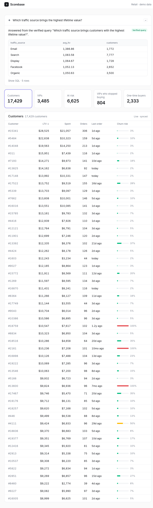

# Scorebase

Raw customer data in, precomputed scores out, served to an app that syncs live and answers plain-English questions.
Everything domain-specific lives in YAML under `configs/<name>/`. The engine never mentions customers or orders.



```
 configs/retail/*.yaml          sources · scores · segments · semantic model · golden queries
 ════════════════════ engine (Python, generic) ════════════════════
 load      raw tables into the warehouse (DuckDB locally, Snowflake in prod)
 score     one entity_scores table; scores ordered by their dependencies
 segments  structured rules → SQL counts (same rules run in the browser via Zero)
 publish   warehouse → Postgres, writing only rows that changed
 api       guarded read-only SQL + golden-question matching for the Ask box
 ════════════════════ app (TypeScript) ════════════════════════════
 Zero      Postgres → zero-cache → browser; named queries only (/api/zero/query)
 UI        TanStack Start · React 19 · Tailwind · Recharts
 Ask       verified (golden) query first; otherwise a Mastra + Claude agent writes SQL
```

## Run it

```bash
make setup          # venv, pnpm install, Postgres (wal_level=logical) in Docker
make data           # 20K synthetic customers → scores → Postgres
make api            # terminal 1: query API   :8787
make zero           # terminal 2: Zero sync   :4848
make app            # terminal 3: web app     :3000
make test           # 13 engine tests, 5/5 golden queries, app typecheck
```

Optional: put `ANTHROPIC_API_KEY=...` in `app/.env` so the Ask box can answer questions that no verified query covers.

## What's verified

| Check | Result |
|---|---|
| Engine tests (scorer layering, cycles, SQL guard, end-to-end, second domain) | 13/13 |
| Golden queries through the guard | 5/5 |
| Re-publish with no changes | 0 rows written |
| Edit one row in Postgres | shows in the open page in ~1.5s, no reload |
| Ask box, verified path | answers + Show SQL in the browser |
| Ask box, agent path (Mastra + Claude) | typechecks; not yet run, needs an API key |
| Snowflake warehouse | code written; not yet run, needs an account |

## Notes

- **Data:** `generate` writes files with TheLook's table and column names. To use the real BigQuery
  `thelook_ecommerce` export, point the paths in `configs/retail/sources.yaml` at it.
- **Generic:** `tests/test_engine.py::test_engine_is_generic` scores countries from labor statistics
  with the same engine and only a different config.
- **Synthetic data caveat:** order rates have a long tail, so the top few customers have 300+ orders.
